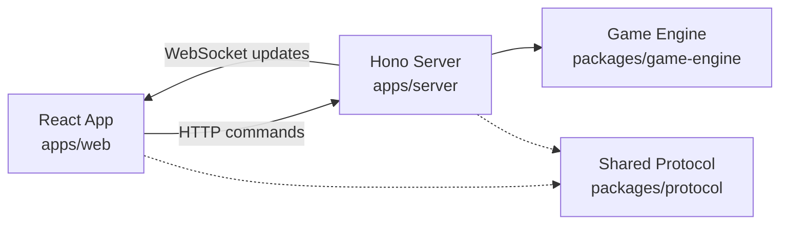

# Regicide

A web implementation of the cooperative card game **Regicide**, featuring real-time multiplayer and AI teammates.

Play solo or team up with friends to defeat 12 increasingly powerful enemies. Use your cards strategically, combine suit abilities, and survive each enemy's counterattack to defeat the final King.

**[Play Live](https://p01--regicide--kg8qpkjrb69v.code.run)** · **[Game Rules](docs/regicide-rules.md)**

## Features

- **Cooperative multiplayer** — Play with up to four players, including AI teammates.
- **AI teammates** — Configure different language models to participate in your team.
- **Real-time gameplay** — Share invitation links and receive live game updates through WebSockets.
- **Session restoration** — Refresh your tab and reconnect to the same game and player identity.
- **Card animations** — Visualize attacks, suit abilities, card draws, and enemy defeats.

## Tech Stack

| Area | Technologies |
| --- | --- |
| Frontend | React 19, TypeScript, Vite 8, Tailwind CSS 4, Motion |
| Backend | Node.js, Hono 4, WebSockets |
| Game logic | Independent TypeScript game engine |
| Communication | HTTP, WebSockets, Valibot |
| AI | OpenRouter, structured LLM outputs |
| Tooling & deployment | pnpm monorepo, Docker |

## Architecture

Regicide follows a **server-authoritative architecture** built around a framework-independent game engine.



The monorepo separates responsibilities into four packages:

- **`apps/web`** — React UI, player interactions, session management, and animations.
- **`apps/server`** — Game sessions, authentication, WebSockets, and AI coordination.
- **`packages/game-engine`** — Pure game rules, validation, and state transitions.
- **`packages/protocol`** — Shared, runtime-validated client/server contracts.

### Key Design Decisions

**Server-authoritative gameplay**

Clients submit actions, not game-state changes. The server authenticates each player and uses the game engine to validate and execute their commands. Only accepted actions update the authoritative state.

This keeps game rules and turn order consistent across human and AI players.

**Independent game engine**

The game engine contains the rules and state transitions without dependencies on React, HTTP, WebSockets, or AI providers.

Separating domain logic from infrastructure makes the rules easier to test, maintain, and reuse.

**Player-specific information**

The server constructs a different game view for each player. Players see their own cards, but only the hand sizes of their teammates.

Hidden information, such as the deck order or other players' cards, is never exposed to clients or AI teammates.

**Animations are presentation, not game state**

The server publishes authoritative game views and ordered outcome events. The frontend uses those events to animate card movements and intermediate effects.

If synchronization is interrupted, animations can be skipped in favor of the latest server state. Visual presentation never determines game correctness.

**Session restoration without accounts**

Players receive game-scoped credentials, stored in the browser's `sessionStorage`. Refreshing a tab restores the same player identity and fetches the latest game state, without requiring an account or occupying another player slot.

## AI Teammates

One of the main features of Regicide is the ability to **play cooperatively with AI-controlled teammates**.

Rather than bypassing the rules, AI players participate through the same authoritative game engine as human players.

### How it works

1. **Observation** — When an AI teammate must act, the server builds an observation from that player's game view, respecting hidden information.
2. **Decision** — The selected language model receives the game context and proposes a structured player command.
3. **Validation** — The server checks that the decision is still current and passes the command through the game engine.
4. **Execution** — If valid, the server commits the action and broadcasts the updated game state.

The language model chooses what to attempt, but **the game engine always decides what is legal**.

### Agent Coordination & Reliability

AI turns are coordinated by the server. Each AI teammate has an assigned model, and the server requests decisions only when that teammate needs to act.

The coordinator handles stale responses, provider errors, and invalid commands without compromising the game state. Failed decisions pause the AI teammate, allowing the host to retry or adjust its configuration.

Committing a game action is also separate from notifying clients and scheduling subsequent AI work, so a notification failure cannot undo an accepted move.

### Supported Models

AI teammates currently support:

- **GPT-5 Mini**
- **DeepSeek V3.2**

Models are accessed through **OpenRouter**. The host configures an API key and available models in AI Settings before creating a game with AI teammates.

A shared request budget limits the total number of AI requests per game. It is a request-count limit, not a monetary spending limit.

## Getting Started

### Requirements

- Node.js 24
- pnpm 11.28.4

Clone the repository and run:

```bash
pnpm install
pnpm dev
```

Open **http://localhost:3001** to play.

The frontend runs through Vite and connects to the Hono server at `http://localhost:3000`.

Solo games and human multiplayer work without an AI provider key. AI teammates require an OpenRouter API key configured through the application.

### Verification

Run the repository checks and game-engine tests:

```bash
pnpm check
pnpm --filter @regicide/game-engine test
```

With the server running, you can also verify the HTTP contracts using [Hurl](https://hurl.dev/):

```bash
pnpm verify:http
```

## Tradeoffs & Limitations

Some decisions intentionally keep the project focused on gameplay rather than infrastructure:

- **In-memory sessions** — Games and AI profiles are stored in server memory. Refreshing a tab restores a player session, but restarting the server loses active games.
- **No user accounts** — Player credentials are scoped to a game and browser tab. AI profile credentials are not restored after a refresh.
- **Snapshot-based reconnection** — WebSocket reconnects retrieve the latest state rather than replaying missed events or animations.
- **External AI providers** — AI teammates depend on the configured model provider's availability and responses.

These tradeoffs keep the implementation centered on the game rules, multiplayer consistency, and AI integration.

## Further Reading

- [Game Rules](docs/regicide-rules.md)
- [Server API & WebSocket Documentation](apps/server/README.md)
- [AI Agent Architecture](apps/server/src/agents/README.md)

## Acknowledgments

Regicide is an independent web implementation of the cooperative card game designed by **Paul Abrahams, Luke Badger, and Andy Richdale**, published by **Badgers from Mars**.

Learn more about the original game at [regicidegame.com](https://www.regicidegame.com/).

This project is not affiliated with the original game's creators or publisher.
